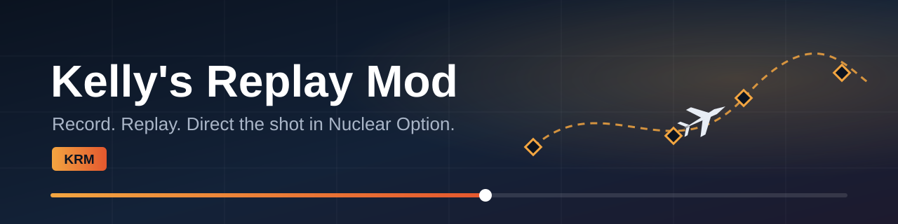

<p align="center">
  
</p>

<p align="center">
  
  
</p>

<p align="center">
  <b>Record Nuclear Option missions and multiplayer sessions, then turn them into trailer shots</b><br>
  with a replay timeline, free and tracking cameras, camera paths, slow motion, weather and lighting tools.
</p>

<p align="center">
  <a href="#-install">Install</a> ·
  <a href="#-first-shot-in-five-steps">Quick start</a> ·
  <a href="#-controls">Controls</a> ·
  <a href="#-features">Features</a> ·
  <a href="#-building-from-source">Build</a> ·
  <a href="https://discord.gg/FhsqkbgtWS">Discord</a>
</p>

---

## ✨ Features

| | |
|---|---|
| 🎥 **Replay studio** | Timeline scrubbing, play/pause, slow motion and time-lapse, frame-accurate seeking forwards and backwards. |
| 🛩️ **Cameras** | Free camera, chase, orbit, cockpit and copilot seats, fixed-angle follow, two-aircraft framing and camera rails. |
| 🧭 **Camera paths** | Keyframe position, aim, roll and FOV. Constant, smooth or jump transitions, with per-replay projects saved beside the recording. |
| 💡 **Lighting & weather** | Place, colour and aim custom point and spot lights, control aircraft navigation and landing lights, and change time of day and weather. |
| ⏺️ **Recording** | Record whole sessions or keep a rolling buffer of recent gameplay (30 seconds to 5 minutes) and save it with one key. |
| 🧰 **Reliability** | Recordings are integrity-checked before they reach the library; interrupted recordings can be recovered, and deleted ones go to a recovery folder. |
| 🚀 **Faithful combat** | Missiles, rockets and bombs leave the aircraft as recorded, including bay drops and rail launches, and explosions happen exactly where the recording says. |

## 📦 Install

> Requires **Nuclear Option for Windows** and **[BepInEx 5.x (64-bit)](https://github.com/BepInEx/BepInEx/releases)**.

1. Download `Kellys-Replay-Mod-1.0.zip` from **[Releases](../../releases)**.
2. Close the game and copy the package's `BepInEx` folder into the game folder.  
   The plugin should end up at `BepInEx/plugins/ReplayMod/Kellysreplaymod.dll`.
3. **Upgrading?** Remove any older `ReplayMod.dll` or `Kellysreplaymod.dll` first, so only one copy is installed. Your configuration, `Replays` folder and camera projects are kept.

KRM is a client mod; don't install it on a headless server. New recordings use **replay format 12**, which older ReplayMod builds cannot open. Older supported recordings remain readable.

## 🎬 First shot in five steps

1. Press **F5** to open the studio. Open **Record**, record your mission, then stop and save before leaving it.
2. Open **Library**, select the recording and choose **Open selected replay**. The mod checks the file, terrain and units first.
3. Pick a moment with the timeline and speed controls, then choose a subject and view in **Camera → View**.
4. In **Camera → Path**, compose a view and **Add point here**. Seek, compose again and add another point. **Preview** plays the path.
5. Press **F8** to hide every UI element and capture with OBS or your favourite recorder.

## ⌨️ Controls

| Action | Default key |
|---|---|
| Open / close the studio | <kbd>F5</kbd> |
| Clean capture (hide all UI) | <kbd>F8</kbd> |
| Save recent gameplay | <kbd>F9</kbd> |
| Start / stop recording | <kbd>I</kbd> |
| Play / pause replay | <kbd>Space</kbd> |
| Roll camera left / right | <kbd>Z</kbd> / <kbd>C</kbd> |
| Level camera | <kbd>X</kbd> |
| Add / delete last path point | <kbd>F6</kbd> / <kbd>F7</kbd> |
| Free camera rise / descend | <kbd>R</kbd> / <kbd>F</kbd> |
| Slow motion | the game's Slow Motion binding (<kbd>,</kbd>) |

Every studio shortcut can be reassigned in **Help → Shortcuts**.

## 🧩 Feature details

<details>
<summary><b>Camera tools</b></summary>

- **Cockpit seats:** pilot, copilot and other supported crew positions. Crew meshes are hidden in eye views to avoid clipping.
- **Two-aircraft framing:** keeps two subjects in shot and adjusts distance as they separate.
- **Fixed-angle follow:** hold a world angle or rotate with the aircraft; lock a view composed in free camera.
- **Rails:** steady camera movement in a chosen direction, optionally matching the subject's speed.
- **Camera through terrain:** optionally bypass collision for impossible shots.

</details>

<details>
<summary><b>Camera paths and projects</b></summary>

- Each point stores position, aim, roll and FOV, and can be restored exactly by clicking it.
- Constant, Smooth or Jump transitions between points.
- Projects (paths, bookmarks, scene settings and lights) are saved as a `.director.json` sidecar next to the replay.

</details>

<details>
<summary><b>Scene and lighting</b></summary>

- Custom point and spot lights with colour, colour temperature, aim and patterns.
- Aircraft navigation and landing lights: Recorded, On or Off, plus blackout.
- Replay weather and time of day, including day-to-night time-lapse.

</details>

<details>
<summary><b>Recording and library</b></summary>

- Recordings finalize automatically when a mission ends and are checked before publication.
- **Library → Recovery** recovers a copy of an interrupted recording; the original partial is kept.
- **Library → Check recording integrity** verifies frame checksums.
- Bulk deletion moves recordings to `Replays/Deleted recordings`.

</details>

## 🐞 Reporting a problem

Use **Help → Support → Export logs** to create a support ZIP, then open an issue or post in the [Kelly D Rippers Mods Discord](https://discord.gg/FhsqkbgtWS). Include what you were doing, the mod and game versions, and whether the recording came from a host or a client. The replay and its `.director.json` help a lot.

> The support ZIP can contain player and mod names and file paths, so check it before posting publicly.

Known limitations are listed in the [release notes](release-docs/RELEASE-NOTES.md) and [validation notes](release-docs/VALIDATION.md).

## 🛠️ Building from source

**Prerequisites:** Windows, the [.NET SDK](https://dotnet.microsoft.com/download) (8.0 or newer) and an installed copy of Nuclear Option with BepInEx 5. The build references the game's own assemblies.

```powershell
# Build the plugin, audit its inputs and run the regression suite
./build-local.ps1 -GameDir "C:\Program Files (x86)\Steam\steamapps\common\Nuclear Option"

# Package the player and source archives into ../READY-TO-RELEASE
./package-release.ps1
```

The plugin is written to `src/bin/Release/net472/ReplayMod.dll` and ships as `Kellysreplaymod.dll`. Builds are deterministic: the same source and game version produce the same plugin hash.

Native API contracts can be checked against your installed game:

```powershell
dotnet run --project tests/Audit/Audit.csproj -c Release -- src/bin/Release/net472/ReplayMod.dll "<GameDir>\NuclearOption_Data\Managed\Assembly-CSharp.dll"
```

<details>
<summary><b>Repository layout</b></summary>

| Path | Contents |
|---|---|
| `src/` | The BepInEx plugin: recorder, playback, studio UI, camera director and Harmony patches. |
| `tests/Regression/` | Game-independent regression suite run by `build-local.ps1`. |
| `tests/Audit/` | Native contract audit against the installed game assemblies. |
| `probe/` | In-game test harness used for isolated runtime acceptance. |
| `tools/` | Build-input audit. |
| `release-docs/` | Player-facing README, release notes and validation notes packaged with releases. |

</details>

## 💚 Thank you

A huge thank you to the people who spent months testing, bug hunting, requesting features and offering massively appreciated support:

- **Enplo**: [YouTube](https://www.youtube.com/channel/UCXho3MN24cEPnsQ_VDzur8Q)
- **Shutter**: [YouTube](https://www.youtube.com/channel/UCbwrfYzULVGh4uNZa48hv6Q)
- **Zephyrine**: [YouTube](https://www.youtube.com/channel/UCukJUnp5UFpZTCpkYW4K6xw)
- **theLV2**: [YouTube](https://www.youtube.com/channel/UCnDZw6SDd3y-oB_W63bIH1w)
- **At0m|c**
- **Dodobirdie**: [YouTube](https://www.youtube.com/channel/UCK2lw04A4XZGJxh3Geaf92A)
- **Snejokes**

I couldn't have done it without them. Their time and input have massively shaped this mod, and I am hugely thankful. I hope this tool gives them what they need to enjoy creating the content they love to make.

## 🙏 Credits

Original [ReplayMod](https://github.com/chiester3105/ReplayMod) by **chiester3105**. Continued as Kelly's Replay Mod by **Brig. Gen. Kelly D. Ripper**, with the original author's permission.

Third-party components are listed in [THIRD-PARTY-NOTICES.txt](THIRD-PARTY-NOTICES.txt).

<p align="center"><sub>Community and support: <a href="https://discord.gg/FhsqkbgtWS">Kelly D Rippers Mods on Discord</a></sub></p>
